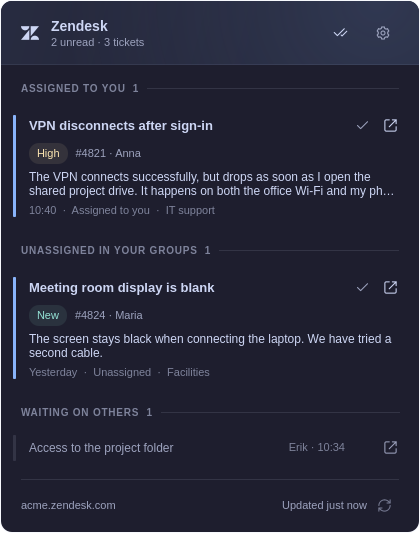

# Foamy Zendesk

An Omarchy bar plugin for your Zendesk tickets: the unsolved tickets assigned
to you, and the unassigned ones in your groups. It signs in with OAuth and
reads only; nothing in Zendesk changes. Desktop notifications are optional
(off by default).



The bar shows the Zendesk icon followed by a red count of unread tickets,
like Teams. Click it to open the inbox: your tickets under **Assigned to
you**, then **Unassigned in your groups**. Unread tickets have a bold
subject with an accent-coloured dot by the time (10:40 today, then Yesterday, a weekday
or a date), their status and priority (only when not Open or Normal), who
wrote last ("You" for your own replies), the latest comment, and a footer
line with the assignee and the group. Read tickets take one line.

Click a ticket to open it; one ticket is open at a time. An open ticket gets
a frame and a tinted header band: click the band to close it (clicks on the
comments never do). Its comments show newest first: those that were unread
and the one before them, and **Show earlier comments** for the rest
(internal notes labelled). Long comments are clipped at six lines and fade
out, each with its own **Show more** and **Show less**. Icon buttons in each title row offer **Mark as read** and
**View in Zendesk** (opens the ticket in the browser). Notices (Undo,
waiting updates) float in a bar above the footer, so they never move the
ticket being read. The footer shows the account, when the inbox was last
updated (or why it couldn't be, or when it tries again), and **Refresh**.

Zendesk has no per-agent read state, so reading is kept on this computer. A
ticket is unread while it has comments from someone else newer than when you
marked it read; your own replies never make it unread. **Opening a ticket
marks it read**: the count drops at once, while the open ticket keeps its
place and its "new" marks until it closes (then it moves, or hides with
**Hide read tickets**). Read tickets stay listed, dimmed; their **Mark as
unread** button shows while the pointer or the keyboard cursor is on the
ticket. The header's **Mark all as read** marks every unread ticket; an
Undo link restores that batch. Viewing a ticket in Zendesk changes nothing.

Settings (in the ⋯ menu, `s`, or right-click the bar icon):

- **Hide read tickets** (off), **Show unread first** (off), and **Group
  waiting tickets** (on): Pending and On-hold tickets you have read move to a
  "Waiting on others" section at the end; a new reply brings them back up.
- **Desktop notifications** (Off, **Assigned to you** or **All tickets**,
  which adds the unassigned ones in your groups): a notification when a
  fetch finds a ticket new to the inbox or a new comment from someone else
  on one that is still unread, with the Zendesk icon. Click it to open the
  inbox with that ticket open (which marks it read); its buttons are **View
  in Zendesk** (opens it in the browser and marks it read) and **Mark as
  read**. Several at once make one notification listing them, with **Mark
  all as read**. The buttons read only up to the comments announced, so a
  reply that came in since stays unread. Nothing is announced while an inbox
  popup is open, outside the schedule or while snoozed, and the first inbox
  after the shell starts or you sign in only sets what counts as new (also
  for its tickets whose comments come on a later check: only comments
  written after it are announced). A notification belongs to the account it
  came from: while another Zendesk address is set, its buttons do nothing
  and a click only opens the inbox.
  Zendesk can't push to the desktop (its webhooks need a public server and
  an admin), so a notification comes with the next check: up to **Check
  every** late, plus however far Zendesk's search lags.
- **Use a weekly schedule**: per-day working hours (local time; overnight
  ranges carry into the next day), as in Foamy Train. Outside them nothing is
  fetched in the background and the bar icon dims without its count, or the
  widget hides (it stays while its popup is open). Opening the popup still
  refreshes the inbox, and **Refresh** works; the footer's refresh icon spins
  while it loads.
- **Snooze until tomorrow** (in the ⋯ menu): mutes the widget until
  tomorrow, like being outside the schedule. A snooze lasts until today's
  scheduled hours end (an overnight range runs on past midnight), or until
  midnight without a schedule. Snoozed, the entry reads **Stop snoozing**;
  outside the schedule it reads **Resume now** and turns the widget on until
  midnight (or until the schedule starts, if sooner). Either goes back to
  the schedule when pressed again. Snoozing is kept in
  `$XDG_STATE_HOME/foamy-zendesk/schedule-override.json`, never in `shell.json`.
- **Zendesk** (at the bottom): the account, and **Check every** (1 to 15
  minutes, default 1). Signed out, it also holds the connection fields below.

If any monitor has an open ticket, a newer inbox waits until it closes (or
its panel does), so text and order stay stable while reading.

## Languages

English and Norwegian (`i18n/en.json`, `i18n/no.json`), following the
shell's language. Every text the panel shows is a catalog key, including the
helper's errors (only an internal failure passes on the system's own error
text): their varying details (an HTTP status, a port) follow the key after
U+001F separators and fill its `%1`, `%2`. `tests/i18n.test.cjs` checks that
both catalogs cover the plugin, the kit components, ticket statuses and
priorities, day names and the helper's errors (also those it takes from the
kit, such as `tls::UNSUPPORTED`, read from `kit/rust`), with matching
placeholders and no unused entries.

## Zendesk sign-in

OAuth only: the authorization code grant with PKCE for a **public** OAuth
client, so there is no client secret and no API token. Nothing about the
account is hard-coded:

- **Zendesk address**: `acme` or `acme.zendesk.com`.
- **OAuth client ID**: the client's unique identifier.
- **Redirect port**: empty means 47823 (shown as the placeholder). It must
  match the client's redirect URL, which the section shows.

A Zendesk admin creates the OAuth client once, in Admin Center › Apps and
integrations › APIs › OAuth clients: kind **Public**, redirect URL
`http://127.0.0.1:47823/callback` (or your port), allowed scope `read`.

**Sign in** (it saves fields still being typed) opens the browser; the helper
listens on `127.0.0.1` only, checks the `state` value, exchanges the code at
once and shows who is signed in. Tokens are stored in the Secret Service
keyring (through `secret-tool`), never in the plugin settings, a file or a
log; the panel only learns the outcome. Access tokens are refreshed when they
expire, and the new pair is stored before it is used (Zendesk invalidates the
old one). An expired refresh token shows "Sign-in expired". **Sign out**
removes the token from the keyring and revokes it; a refresh still running
finishes first (up to 30 seconds), so the pair it stores is the one removed.
If it takes longer, sign-out still clears the keyring but says it didn't
finish: try again.

Refreshes, sign-in and sign-out take a lock in `$XDG_RUNTIME_DIR/foamy-zendesk/`
(owner-only) and never write the keyring without it. When that lock can't be
used (no `$XDG_RUNTIME_DIR`, or its filesystem is full or read-only), an
expiring sign-in isn't renewed (the inbox says why, and checking resumes once
the lock works; the stored sign-in stays valid), **Sign in** refuses to start,
and **Sign out** clears and revokes the token but says it didn't finish:
fix the runtime directory and try again.

## Fetching

Every minute (your **Check every**) while signed in and within the schedule,
and, in or outside the schedule, when the popup opens on an inbox older than
30 seconds or on **Refresh**, the helper's `fetch`:

- searches `type:ticket status<solved assignee:me`, and
  `type:ticket status<solved assignee:none group:<id>` for each of your groups
  (up to 20 groups and the 100 most recently updated tickets, and the list
  says so below its last ticket when either left some out; Zendesk's search
  can lag a few minutes behind);
- fetches the latest 20 comments only for tickets whose `updated_at` changed
  (at most 25 tickets and about 8 MB of comments per run, the most recently
  updated first; the rest follow next run) and shows their plain text,
  with the HTML entities Zendesk leaves in it (`&nbsp;`, `&amp;`, …) decoded
  and blank lines collapsed;
- looks up the names of assignees, requesters and comment authors in one call.

Failures back off (2×, 4×, … up to 15 minutes) and keep the last inbox. Read
markers live in `$XDG_STATE_HOME/foamy-zendesk/read-<host>.json`, such as
`read-acme.zendesk.com.json` (private directory); markers of tickets that left
the inbox are kept 30 days, and at most the 2000 most recently marked are
loaded. A read file that exists but can't be read is left alone: markers
then last until the shell restarts or the account changes.

Requirements: `secret-tool` (libsecret) with a running keyring (Omarchy's
gnome-keyring). HTTPS needs AES, carry-less multiply, AVX2, BMI2 and ADX on
x86-64 (Intel Broadwell, AMD Zen or newer), or the crypto extensions on ARMv8
(a Raspberry Pi 5, not a Pi 4); without them the panel says HTTPS isn't
supported on this CPU. The helper is `bin/<arch>/foamy-zendesk-helper`, built
from `native/` with the foamy-kit native toolchain; its contract is the
comment at the top of `native/src/main.rs`.

## Keyboard

Arrows or hjkl move a single cursor over the header actions, tickets and
their actions in on-screen order, then Refresh. Enter or Space activates,
Escape closes, and Tab switches shell panels. `r` refreshes, `m` opens the
ticket under the cursor, then shows one more thing per press (the newest
clipped comment in full, then the earlier comments), `u` undoes Mark all as read
and `s` opens settings.

IPC: `omarchy-shell foamy.zendesk <open|close|toggle|settings|snooze>` (`snooze`
is the ⋯ menu's snooze entry). A notification uses `show <host>/<ticket id>`
(the inbox with that ticket open), `viewInZendesk <host>/<id>:<comment id>`
and `markRead <host>/<id>:<comment id>[,…]` (read up to that comment), where
`<host>` is the account's, such as `acme.zendesk.com`. With another host, or
none, they change nothing: `show` opens only the inbox.

## Install

Requires Omarchy 4.5.

```sh
omarchy plugin add https://github.com/foamrider/foamy-zendesk.git --enable
```

To remove it, sign out first (that revokes the token and removes it from the
keyring), then run `omarchy plugin remove foamy.zendesk`. Read markers stay in
`$XDG_STATE_HOME/foamy-zendesk/`.

## Verifying the helper binaries

`bin/x86_64/foamy-zendesk-helper` and `bin/aarch64/foamy-zendesk-helper` are compiled from the Rust source in this repository: `native/`, the
shared crate in `kit/rust/`, the dependencies locked in `Cargo.lock` and the
toolchain pinned in `rust-toolchain.toml`, with the build tool in
`kit/native/`. The build is reproducible. `native/native.pin` records the
toolchain, a hash of every build input (`source`) and the SHA-256 of each
binary.

**CI.** The [Verify native helpers](https://github.com/foamrider/foamy-zendesk/actions/workflows/verify-native.yml)
workflow rebuilds both binaries on a GitHub-hosted runner for every push,
compares them byte for byte with `bin/`, and attests the rebuilt files. To
check the committed files against that attestation (GitHub CLI):

```sh
gh attestation verify bin/x86_64/foamy-zendesk-helper --repo foamrider/foamy-zendesk \
  --signer-workflow foamrider/foamy-zendesk/.github/workflows/verify-native.yml \
  --deny-self-hosted-runners
gh attestation verify bin/aarch64/foamy-zendesk-helper --repo foamrider/foamy-zendesk \
  --signer-workflow foamrider/foamy-zendesk/.github/workflows/verify-native.yml \
  --deny-self-hosted-runners
```

Add `--source-digest <commit>` to require a particular commit.

**Yourself.** You need `rustup`, Python 3.11 or newer and `file`. From a
checkout of this repository at the commit you want to check:

```sh
rustup toolchain install "$(awk '$1 == "toolchain" { print $2 }' native/native.pin)" \
  --profile minimal --target x86_64-unknown-linux-musl,aarch64-unknown-linux-musl
kit/native/build-native.sh . --verify
```

It builds both binaries from scratch in `~/.cache/foamy-native/` (nothing is
written to the checkout), compares them byte for byte with `bin/`, checks
that the kit files are unmodified and that `native.pin` matches the source,
and ends with `verify OK (foamy-zendesk-helper, <toolchain>, both arches reproducible)`.

### Building the helper yourself

To run binaries you built instead of the committed ones, build them in the
installed plugin with the same toolchain, then run `omarchy restart shell`:

```sh
cd ~/.config/omarchy/plugins/foamy.zendesk
kit/native/build-native.sh .
```

The build is reproducible, so `git status` shows no change when your
binaries match the release, and `omarchy plugin update` still applies.

## License

Licensed under [MIT](LICENSE). Omarchy and Lucide notices are in
[kit/LICENSE-OMARCHY](kit/LICENSE-OMARCHY) and [kit/LICENSE-LUCIDE](kit/LICENSE-LUCIDE).
The Zendesk mark (also in `icons/zendesk.svg`, rendered to the notification
icon `icons/zendesk.png`) comes from [Simple Icons](https://github.com/simple-icons/simple-icons)
(CC0). Zendesk is a trademark of Zendesk, Inc.; this plugin is not affiliated
with or endorsed by Zendesk.

Provided **as is**, without warranty or guaranteed support. Use at your own risk.

## Validation

Uses the existing Quickshell, Node.js, Python and foamy-kit tools. The
runtime test isolates HOME, XDG paths and D-Bus, loads the real Panel, stores
and view offscreen, and runs the real helper (which finds no keyring there);
the inbox comes from `preview/Fixtures.js` (fictional tickets, used only by
the preview and tests) and ticket links go to a stub; switching accounts mid
fetch and mid sign-in uses a stand-in helper. The helper's own tests
use a fake Zendesk on loopback and an in-memory keyring; nothing touches a
real account.

```sh
mise install            # once: the linters and node that mise.toml pins
tests/validate.sh       # kit-check, omarchy-plugin-validate, linters, formatters,
                        # the helper's tests and tests/suite.sh (node, i18n, runtime)
tests/validate.sh --ci  # what GitHub's runner can do: no Quickshell or Omarchy host
KIT=../foamy-kit   # a foamy-kit checkout at the version in foamy-kit.lock
kit/native/build-native.sh . --test     # fmt, clippy, cargo test
kit/native/build-native.sh .            # rebuild bin/<arch>/ and native/native.pin
kit/native/build-native.sh . --verify   # byte-identical clean rebuild
FOAMY_HOST_45=/usr/share/omarchy/shell python3 $KIT/preview/render.py . \
  --host 4.5 --out /tmp/foamy-zendesk-preview
```

The preview covers tickets (one read), expanded content, a waiting inbox,
Mark all as read, hidden read tickets, grouped waiting tickets, signed out,
loading, failed and offline states, an empty inbox, settings (signed in and
signed out), the schedule, outside the schedule, a narrow popup, keyboard
focus and scrolling. Render with `--theme light` to check the light palette.
`FOAMY_KIT` overrides the kit path used by runtime tests (default: a sibling
`foamy-kit`, else `~/GitHub/Personal/foamy-kit`).

Shared components are copied from foamy-kit and pinned by `foamy-kit.lock`.
Change the kit source and sync; never edit its stamped copies here.

The tests run on Omarchy 4.5, the installed `/usr/share/omarchy/shell`
(`FOAMY_HOST_45` picks another 4.5 tree). The installed Qt formatter
cannot process typed `void` IPC methods in `Panel.qml` (also true for existing
Foamy plugins); the runtime test loads and exercises that file without removing
its types.
