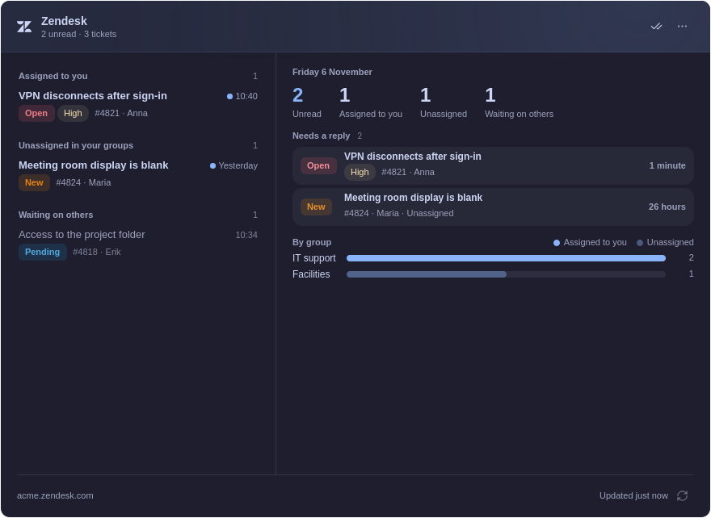

# Foamy Zendesk

An Omarchy bar plugin for your Zendesk tickets: the unsolved tickets assigned
to you, and the unassigned ones in your groups. It signs in with OAuth and
reads only; nothing in Zendesk changes. Desktop notifications are optional
(off by default).



The bar shows the Zendesk icon followed by a red count of unread tickets,
like Teams. When something needs you, a small warning sign sits on the icon:
the sign-in expired or can't be read, or the last checks failed (then the
icon dims and the count stays, as the last one known). The tooltip says
which ("Zendesk — sign-in expired", "2 unread · not updated since 09:12").
On a vertical bar, where the count has no room, a dot on the icon says there
are unread tickets. Click the icon to open the inbox: your tickets under
**Assigned to you**, then **Unassigned in your groups**, each section header
with its count.

Each row has the same columns, so the eye can run down them: the subject,
then the unread dot and the time (10:40 today, then Yesterday, a weekday or
a date), then fixed slots for **Mark as read** and **View in Zendesk**. An
unread row has a bold subject and a second line: the status as a soft tag
in Zendesk's colours, the priority (only High and Urgent; Urgent is a solid
red pill), and "#id · requester"; then the start of the newest comment. That
preview starts at the message: no greeting ("Hi Alex,"), no quoted mail, a
URL as its host, your own reply as "You: …". The disclosure triangle has the
status colour. A read ticket takes one line: the subject, the status unless
it is Open, the priority, the requester and the time. A read ticket that
still waits for you (New or Open, someone else wrote last) keeps the normal
text tones; one that is parked (you wrote last, or it is Pending or On-hold)
is dimmed. A ticket whose comments haven't loaded yet is drawn as unread and
says so.

Click a ticket to open it; one ticket is open at a time, and opening one
below an open one keeps it where you clicked it. An open ticket gets a frame
and a header band with the whole subject, the solid status tag and the
priority, "#id · requester" with whose ticket it is ("Assigned to you",
"Unassigned", "Assigned to …") at the end of the line, and both actions.
Click the band to close it (clicks on the comments never do), or
**Collapse** at the end of the card. While the card is taller than the list,
its header stays at the top of the list. Its comments show newest first:
those that were unread and the one before them, and **Show earlier
comments** for the rest. Each comment has its author, an **Internal note**
label (an internal note lies on a yellow tint), the time and **New**. The
newest unread comment shows 12 lines and the others 6, then fade out, each
with its own **Show more** and **Show less**. The read toggle is an
envelope: open for **Mark as read**, closed for **Mark as unread**.

Notices stand in a bar between the list and the footer, one row each with
its action: "2 updates waiting" with **Show**, "3 marked as read" with
**Undo**, a failed refresh with **Retry**, **Can't open the browser**, and a
save that failed ("Kept only until the shell restarts."). The list ends
above the bar, so a notice never covers or moves the ticket being read, and
a click on the bar never reaches a ticket. The footer shows the account,
how old the inbox is (in red while refreshes fail), and **Refresh**.

Zendesk has no per-agent read state, so reading is kept on this computer. A
ticket is unread while it has comments from someone else newer than when you
marked it read. Your own replies never make it unread, and a reply you wrote
in Zendesk answers what came before it: those comments count as read, also
when you never opened the ticket here. **Mark as unread** after such a reply
makes it unread again until you reply once more. **Opening a ticket marks it
read**: the count drops at once, while the open ticket keeps its place and
its "new" marks until it closes (then it moves, or hides with **Hide read
tickets**). Read tickets stay listed; their **Mark as unread** button shows
while the pointer or the keyboard cursor is on the ticket. The header's
**Mark all as read** (shown only while there is something to mark) marks
every unread ticket; **Undo** restores that batch. **View in Zendesk** marks
the ticket read too, once `xdg-open` has handed it to your default browser;
when that fails the ticket stays unread and the notice bar says **Can't open
the browser**. Nothing in Zendesk changes either way.

Signed out, or when the sign-in needs you, the list says which: **Signed
out**, **Checking the sign-in…**, **Waiting for the browser…** (with
**Cancel**), **Sign-in expired** (with **Sign in**), **Can't sign in** with
the reason, each with its own icon. A first load that fails says
**Couldn't load tickets**, with **Retry**.

**Wide** (Settings › Panel › Size) shows the list and a reading pane side by
side, 880 wide. It is 640 high, and grows with a longer inbox up to 70 % of
the screen (never under 640; smaller only where the screen is). The list
rows are two lines without their own buttons: the subject and the time, then
the tags and "#id · requester". Selecting a ticket (a click or Enter) shows
it in the pane and marks it read. The pane's header has the subject and three
actions: **Mark as read** or **Mark as unread**, **View in Zendesk**, and ×
(**Hide ticket**, back to the overview; a click on the selected row does the
same). Under it, "#5102 · Anna Lindqvist-Johansen" with the assignment at
the right end. Then every comment the helper fetched (the latest 20), newest
first; those that were unread sit under "New comments", your own replies on
an accent tint. The mail a comment quotes at its end (the "On … wrote:" line
and the "> " lines under it) folds behind **Show quoted text**; a comment of
over 40 lines is cut with **Show more**. While a ticket is shown, new
updates wait in the notice bar until you press **Show**. With no ticket
selected the pane shows an overview: the counts of the list's sections,
**Needs a reply** (New or Open tickets where someone else wrote last, by
priority, then unread, then the longest wait; the wait is red for Urgent and
High after an hour; click one to show it; "7 more need a reply" shows the
rest, and tickets whose comments haven't loaded yet are counted as "may need
a reply"), and the tickets per group. Settings keep the same size. Where the
screen has no room for 880, the popup is the standard size.

Settings (in the ⋯ menu, `s`, or right-click the bar icon), in this order:

- **Account** (first, so "Open settings" on the first run lands on it):
  signed in, who you are and **Sign out**. Signed out, what a Zendesk admin
  must create first, the connection fields below, the redirect URL they
  give, then the state and **Sign in**.
- **Size** (Wide): **Wide** has the reading pane, as above; **Small** is the list alone. **Refresh
  every** (1 to 15 minutes, default 1).
- **Hide read tickets** (off), **Show unread first** (off), and **Group
  waiting tickets** (on): Pending and On-hold tickets you have read move to a
  "Waiting on others" section at the end; a new reply brings them back up.
- **Desktop notifications** (Off, **Assigned to you** or **All tickets**,
  which adds the unassigned ones in your groups): a notification when a
  fetch finds a ticket new to the inbox or a new comment from someone else
  on one that is still unread, with the Zendesk icon. Click it to open the
  inbox with that ticket open (which marks it read); its buttons are **View
  in Zendesk** (opens it in the browser and, once that worked, marks it
  read) and **Mark as read**. Several at once make one notification listing
  them, with **Mark all as read**. The buttons read only up to the comments announced, so a
  reply that came in since stays unread. Nothing is announced while an inbox
  popup is open, outside the schedule or while snoozed, and the first inbox
  after the shell starts or you sign in only sets what counts as new (also
  for its tickets whose comments come on a later check: only comments
  written after it are announced). A notification belongs to the account it
  came from: while another Zendesk address is set, its buttons do nothing
  and a click only opens the inbox.
  Zendesk can't push to the desktop (its webhooks need a public server and
  an admin), so a notification comes with the next check: up to **Refresh
  every** late, plus however far Zendesk's search lags.
- **Use a weekly schedule**: per-day working hours (local time; overnight
  ranges carry into the next day), as in Foamy Train. Outside them nothing is
  fetched in the background and the bar icon dims without its count, or the
  widget hides (it stays while its popup is open). Opening the popup still
  refreshes the inbox, and **Refresh** works; the footer's refresh icon spins
  while it loads.
- **Snooze until tomorrow** (in the ⋯ menu): mutes the widget until
  tomorrow, like being outside the schedule. A snooze lasts until today's
  scheduled hours end (an overnight range runs on past midnight), or until
  midnight without a schedule. Snoozed, the entry reads **Stop snoozing**;
  outside the schedule it reads **Resume now** and turns the widget on until
  midnight (or until the schedule starts, if sooner). Either goes back to
  the schedule when pressed again. Snoozing is kept in
  `$XDG_STATE_HOME/foamy-zendesk/schedule-override.json`, never in `shell.json`;
  when that file can't be written the notice bar says **Can't save snooze or
  resume**, and the snooze lasts until the shell restarts.

If any monitor has an open ticket, a newer inbox waits until it closes (or
its panel does, or you press **Show**), so text and order stay stable while
reading.

## Languages

English and Norwegian (`i18n/en.json`, `i18n/no.json`), following the
shell's language. Every text the panel shows is a catalog key, including the
helper's errors (only an internal failure passes on the system's own error
text): their varying details (an HTTP status, a port) follow the key after
U+001F separators and fill its `%1`, `%2`. `tests/i18n.test.cjs` checks that
both catalogs cover the plugin, the kit components, ticket statuses and
priorities, day names and the helper's errors (also those it takes from the
kit, such as `tls::UNSUPPORTED`, read from `kit/rust`), with matching
placeholders and no unused entries.

## Zendesk sign-in

OAuth only: the authorization code grant with PKCE for a **public** OAuth
client, so there is no client secret and no API token. Nothing about the
account is hard-coded:

- **Zendesk address**: `acme` or `acme.zendesk.com`.
- **OAuth client ID**: the client's unique identifier.
- **Redirect port**: empty means 47823 (shown as the placeholder). It must
  match the client's redirect URL, which the section shows.

A Zendesk admin creates the OAuth client once, in Admin Center › Apps and
integrations › APIs › OAuth clients: kind **Public**, redirect URL
`http://127.0.0.1:47823/callback` (or your port), allowed scope `read`.

**Sign in** saves fields still being typed, then opens the browser. It does
not start while such a save is refused (the field then shows the saved value
again, and the settings page says why) or still waits behind another save.
The helper listens on `127.0.0.1` only, checks the `state` value, exchanges
the code at once and shows who is signed in. While the sign-in waits for
the browser, the connection fields are dimmed and take no input; to change
them, press **Cancel** first. Tokens are stored in the Secret Service
keyring (through `secret-tool`), never in the plugin settings, a file or a
log; the panel only learns the outcome. Access tokens are refreshed when they
expire, and the new pair is stored before it is used (Zendesk invalidates the
old one). An expired refresh token shows "Sign-in expired". A new pair the
keyring can't store, at sign-in or on a refresh, is revoked at once: sign-in
then says why, and a refresh shows "Sign-in expired", since the stored pair
was already spent. A new pair at sign-in is also revoked when Zendesk then
doesn't return the signed-in user. A sign-in over a stored one revokes the
stored pair once the new one is in the keyring. **Sign out**
removes the token from the keyring and revokes it; a refresh still running
finishes first (up to 30 seconds), so the pair it stores is the one removed.
If it takes longer, sign-out still clears the keyring but says it didn't
finish: try again. When the sign-in is in a locked keyring and its unlock
prompt is dismissed, sign-out removes and revokes nothing and says so; the
account stays signed in until you unlock the keyring and sign out again. A
locked keyring is never taken for "Not signed in": a check says it is
locked, and the sign-in works again once it is unlocked.

Refreshes, sign-in and sign-out take a lock in `$XDG_RUNTIME_DIR/foamy-zendesk/`
(owner-only) and never write the keyring without it. When that lock can't be
used (no `$XDG_RUNTIME_DIR`, or its filesystem is full or read-only), an
expiring sign-in isn't renewed (the inbox says why, and checking resumes once
the lock works; the stored sign-in stays valid), **Sign in** refuses to start,
and **Sign out** clears and revokes the token but says it didn't finish:
fix the runtime directory and try again.

## Fetching

Every minute (your **Refresh every**) while signed in and within the schedule,
and, in or outside the schedule, when the popup opens on an inbox older than
30 seconds or on **Refresh**, the helper's `fetch`:

- searches `type:ticket status<solved assignee:me`, and
  `type:ticket status<solved assignee:none group:<id>` for each of your groups
  (up to 20 groups and the 100 most recently updated tickets, and the list
  says so below its last ticket when either left some out; Zendesk's search
  can lag a few minutes behind);
- fetches the latest 20 comments only for tickets whose `updated_at` changed
  (at most 25 tickets and about 8 MB of comments per run, the most recently
  updated first; the rest follow next run) and shows their plain text,
  with the HTML entities Zendesk leaves in it (`&nbsp;`, `&amp;`, …) decoded
  and blank lines collapsed;
- looks up the names of assignees, requesters and comment authors in one call.

Failures back off (2×, 4×, … up to 15 minutes) and keep the last inbox. Read
markers live in `$XDG_STATE_HOME/foamy-zendesk/read-<host>.json`, such as
`read-acme.zendesk.com.json` (private directory); markers of tickets that left
the inbox are kept 30 days, and at most the 2000 most recently marked are
loaded. A read file that exists but can't be read is left alone, and one
that can't be written (a full or read-only disk) isn't saved: either way the
notice bar says **Can't save read markers**, and markers last until the shell
restarts or the account changes.

Requirements: `secret-tool` (libsecret) with a running keyring (Omarchy's
gnome-keyring). HTTPS needs AES, carry-less multiply, AVX2, BMI2 and ADX on
x86-64 (Intel Broadwell, AMD Zen or newer), or the crypto extensions on ARMv8
(a Raspberry Pi 5, not a Pi 4); without them the panel says HTTPS isn't
supported on this CPU. The helper is `bin/<arch>/foamy-zendesk-helper`, built
from `native/` with the foamy-kit native toolchain; its contract is the
comment at the top of `native/src/main.rs`.

## Keyboard

Arrows or hjkl move a single cursor over the header actions, tickets and
their actions in on-screen order, then Refresh. Enter or Space activates,
Escape closes, and Tab switches shell panels. `r` refreshes, `m` opens the
ticket under the cursor, then shows one more thing per press (the newest
clipped comment in full, then the earlier comments), `u` undoes Mark all as read
and `s` opens settings. In Wide each ticket is one stop, Enter (or `m`)
selects it, and the pane's stops come after the list: its three actions
(the read toggle, View in Zendesk, Hide ticket) and the conversation (Up and
Down scroll it; at its end the cursor moves on; `m` opens the next folded
part), or the overview's tickets that need a reply and its "more" link.

IPC: `omarchy-shell foamy.zendesk <open|close|toggle|settings|snooze>` (`snooze`
is the ⋯ menu's snooze entry). A notification uses `show <host>/<ticket id>`
(the inbox with that ticket open), `viewInZendesk <host>/<id>:<comment id>`
and `markRead <host>/<id>:<comment id>[,…]` (read up to that comment), where
`<host>` is the account's, such as `acme.zendesk.com`. With another host, or
none, they change nothing: `show` opens only the inbox.

## Install

Requires Omarchy 4.5.

```sh
omarchy plugin add https://github.com/foamrider/foamy-zendesk.git --enable
```

To remove it, sign out first (that revokes the token and removes it from the
keyring), then run `omarchy plugin remove foamy.zendesk`. Read markers stay in
`$XDG_STATE_HOME/foamy-zendesk/`.

## Verifying the helper binaries

`bin/x86_64/foamy-zendesk-helper` and `bin/aarch64/foamy-zendesk-helper` are compiled from the Rust source in this repository: `native/`, the
shared crate in `kit/rust/`, the dependencies locked in `Cargo.lock` and the
toolchain pinned in `rust-toolchain.toml`, with the build tool in
`kit/native/`. The build is reproducible. `native/native.pin` records the
toolchain, a hash of every build input (`source`) and the SHA-256 of each
binary.

**CI.** The [Verify native helpers](https://github.com/foamrider/foamy-zendesk/actions/workflows/verify-native.yml)
workflow rebuilds both binaries on a GitHub-hosted runner for every push,
compares them byte for byte with `bin/`, and attests the rebuilt files. To
check the committed files against that attestation (GitHub CLI):

```sh
gh attestation verify bin/x86_64/foamy-zendesk-helper --repo foamrider/foamy-zendesk \
  --signer-workflow foamrider/foamy-zendesk/.github/workflows/verify-native.yml \
  --deny-self-hosted-runners
gh attestation verify bin/aarch64/foamy-zendesk-helper --repo foamrider/foamy-zendesk \
  --signer-workflow foamrider/foamy-zendesk/.github/workflows/verify-native.yml \
  --deny-self-hosted-runners
```

Add `--source-digest <commit>` to require a particular commit.

**Yourself.** You need `rustup`, Python 3.11 or newer and `file`. From a
checkout of this repository at the commit you want to check:

```sh
rustup toolchain install "$(awk '$1 == "toolchain" { print $2 }' native/native.pin)" \
  --profile minimal --target x86_64-unknown-linux-musl,aarch64-unknown-linux-musl
kit/native/build-native.sh . --verify
```

It builds both binaries from scratch in `~/.cache/foamy-native/` (nothing is
written to the checkout), compares them byte for byte with `bin/`, checks
that the kit files are unmodified and that `native.pin` matches the source,
and ends with `verify OK (foamy-zendesk-helper, <toolchain>, both arches reproducible)`.

### Building the helper yourself

To run binaries you built instead of the committed ones, build them in the
installed plugin with the same toolchain, then run `omarchy restart shell`:

```sh
cd ~/.config/omarchy/plugins/foamy.zendesk
kit/native/build-native.sh .
```

The build is reproducible, so `git status` shows no change when your
binaries match the release, and `omarchy plugin update` still applies.

## License

Licensed under [MIT](LICENSE). Omarchy and Lucide notices are in
[kit/LICENSE-OMARCHY](kit/LICENSE-OMARCHY) and [kit/LICENSE-LUCIDE](kit/LICENSE-LUCIDE).
The Zendesk mark (also in `icons/zendesk.svg`, rendered to the notification
icon `icons/zendesk.png`) comes from [Simple Icons](https://github.com/simple-icons/simple-icons)
(CC0). Zendesk is a trademark of Zendesk, Inc.; this plugin is not affiliated
with or endorsed by Zendesk.

Provided **as is**, without warranty or guaranteed support. Use at your own risk.

## Validation

Uses the existing Quickshell, Node.js, Python and foamy-kit tools. The
runtime test isolates HOME, XDG paths and D-Bus, loads the real Panel, stores
and view offscreen, and runs the real helper (which finds no keyring there);
the inbox comes from `preview/Fixtures.js` (fictional tickets, used only by
the preview and tests) and tickets open in a fake `xdg-open` (which can also
fail); a stand-in helper also covers switching accounts mid fetch and mid
sign-in, failed and refused fetches, sign-out races and a missing helper. The
helper's own tests use a fake Zendesk on loopback and an in-memory keyring;
nothing touches a real account.

```sh
mise install            # once: the linters and node that mise.toml pins
tests/validate.sh       # kit-check, omarchy-plugin-validate, linters, formatters,
                        # the helper's tests and tests/suite.sh (node, i18n, runtime)
tests/validate.sh --ci  # what GitHub's runner can do: no Quickshell or Omarchy host
KIT=../foamy-kit   # a foamy-kit checkout at the version in foamy-kit.lock
kit/native/build-native.sh . --test     # fmt, clippy, cargo test
kit/native/build-native.sh .            # rebuild bin/<arch>/ and native/native.pin
kit/native/build-native.sh . --verify   # byte-identical clean rebuild
FOAMY_HOST_45=/usr/share/omarchy/shell python3 $KIT/preview/render.py . \
  --host 4.5 --out /tmp/foamy-zendesk-preview
```

The preview covers tickets (one read), expanded content, a waiting inbox,
Mark all as read, hidden read tickets, grouped waiting tickets, signed out,
loading, failed and offline states, an empty inbox, settings (signed in and
signed out), the schedule, outside the schedule, a narrow popup, keyboard
focus and scrolling, and Wide: the overview, a selected ticket, a waiting
update, keyboard focus on the overview and on the conversation, an empty
inbox and settings. The "stress" states load a realistic, untidy inbox
(`preview/Stress.js`), with more states per part of the UI: the rows and the
open card, the reading pane (quoted mail, long comments), the overview, each
account state and every notice. Render with `--theme light` to check the
light palette.
`FOAMY_KIT` overrides the kit path used by runtime tests (default: a sibling
`foamy-kit`, else `~/GitHub/Personal/foamy-kit`).

Shared components are copied from foamy-kit and pinned by `foamy-kit.lock`.
Change the kit source and sync; never edit its stamped copies here.

The tests run on Omarchy 4.5, the installed `/usr/share/omarchy/shell`
(`FOAMY_HOST_45` picks another 4.5 tree). QML is formatted with Qt 6.12's
`qmlformat` and the kit's `.qmlformat.ini`, which keeps `Panel.qml`'s typed
`void` IPC methods; the runtime test loads and exercises that file.
